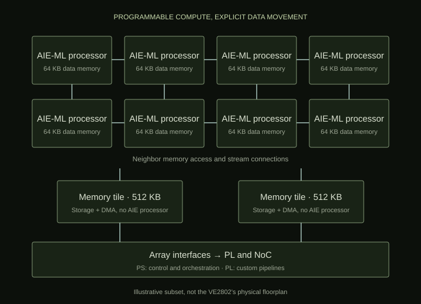
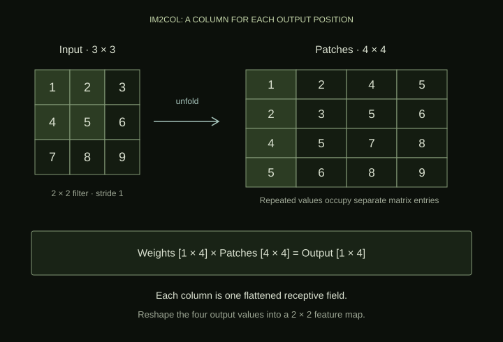
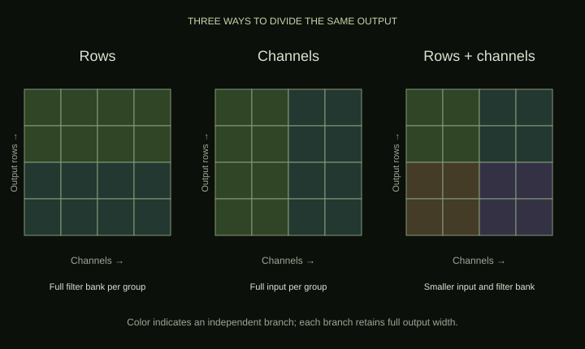
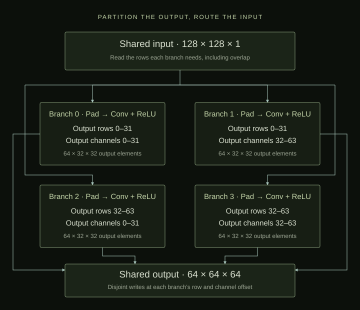
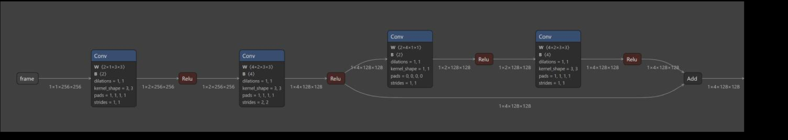
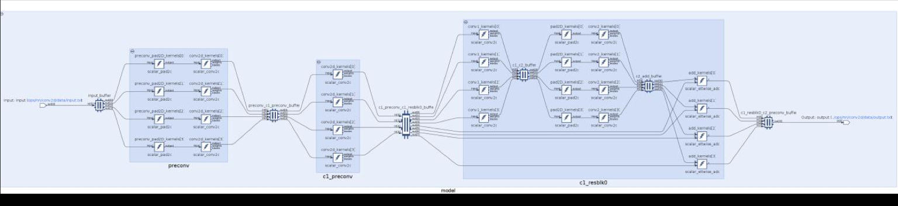

# Custom Core — Implementing CNNs on Spatial Compute

## Introduction

This technical article was part of a greater effort to develop an “ONNX2Versal” compiler that would compile an ONNX neural network for execution on AMD/Xilinx Versal hardware.

The project's main target was computer vision models (e.g., YOLOX), so the first and most foundational piece was to develop a high-performance two-dimensional convolution (Conv2D) implementation on the Versal's array of AI Engines (AIEs).

I developed a parameterizable Conv2D implementation that distributes computation across multiple AIE-ML tiles in the Versal's AIE array. This article outlines the technical challenges and engineering that went into it, with a focus on the AIE-ML V1 architecture and the memory management needed to make that distribution practical.

High performance was the goal. The implementation discussed here establishes the distributed graph and a direct scalar convolution kernel; it does not establish a measured speedup or a completed hardware deployment.

## Understanding the Versal AI Engines

The AMD/Xilinx Versal AIE-ML chip was a pretty interesting architecture because it sits somewhere between a traditional FPGA, a GPU, and a many-core SIMD processor. It combines three major computing architectures on a single chip.

| Component | Purpose | Comparable to |
|---|---|---|
| Processing System (PS) | ARM-based CPUs for orchestration, control, and general software | CPU |
| Programmable Logic (PL) | Reconfigurable FPGA fabric for custom pipelines, interfaces, and acceleration | FPGA |
| AI Engine-ML Array (AIE-ML) | Hundreds of programmable vector processors optimized for ML | Specialized many-core accelerator |

These components communicate through an on-chip network (NoC) and dedicated interfaces.

The important distinction is that AI Engines are actual programmable processors, not FPGA logic. They are hardened silicon cores with their own instruction sets, registers, program memory, and vector execution units. You can program the AI Engines in C/C++ rather than designing all your computation as RTL.

The architecture is especially attractive for real-time inference because it combines substantial compute capability with explicit dataflow and dedicated memories. Sustaining throughput and predictable timing still depends on how computation and communication are scheduled. [AMD's architecture overview](https://docs.amd.com/r/2023.2-English/ug1076-ai-engine-environment/AI-Engine-Architecture-Overview) describes three levels of parallelism.

### Level 1: The AI Engine Tile

Each AI Engine tile contains a programmable processor, local data memory, and communication infrastructure. It facilitates parallelism in two ways.

**SIMD — Single Instruction, Multiple Data.** A single vector instruction can perform many arithmetic operations simultaneously. For example, AIE-ML V1 supports up to 256 INT8 multiply-accumulate operations per clock cycle per tile. That is a peak hardware capability, not the throughput achieved by the scalar kernel in this project. [AMD AI Engine technology](https://www.amd.com/en/products/adaptive-socs-and-fpgas/technologies/ai-engine.html) distinguishes this generation from original AIE and AIE-MLv2.

**VLIW — Very Long Instruction Word.** A single instruction word can issue operations to multiple functional units in parallel. For example, a scheduled loop can overlap two vector loads, a vector store, vector computation, and scalar or address-generation work, subject to dependencies and memory-bank availability. SIMD supplies parallel arithmetic within a vector operation; VLIW overlaps different operations. [AMD's programming guide](https://docs.amd.com/r/2023.2-English/ug1076-ai-engine-environment/AI-Engine-Architecture-Overview) explains this overlap.

### Level 2: The AI Engine Array

A two-dimensional grid of AI Engine tiles forms the AI Engine array. The device I was working on was the Versal AI Edge VE2802, which has 304 AIE-ML tiles. This provides the third form of parallelism: multiple tiles can run concurrently. [AMD's device specifications](https://www.amd.com/en/products/adaptive-socs-and-fpgas/versal/ai-edge-series.html) list the VE2802's array resources.

For ONNX2Versal, that meant I could distribute different parts of a convolution across processors instead of requiring one processor to handle the whole layer. The challenge was deciding what data each processor needed and how to move it there.

### The memory hierarchy changes the problem

Each AIE-ML V1 compute tile has 64 KB of local data memory, organized into banks. A processor can also access neighboring tile memories; the accessible capacity depends on its position in the array. This is a constrained, local memory system, rather than one uniform pool available to every processor. [AMD's data-memory guide](https://docs.amd.com/r/en-US/ug1603-ai-engine-ml-kernel-graph/AI-Engine-Data-Memory) describes the local and neighboring-memory access model.

Separate memory tiles provide 512 KB each and integrated DMA engines. They add shared storage and tensor-address generation without adding another compute processor. Compute tiles communicate through neighboring memories and stream connections, while DMA moves data between streams and memories. [AMD's memory-tile overview](https://docs.amd.com/r/en-US/am020-versal-aie-ml/AIE-ML-Memory-Tile-Overview-and-Features) describes these resources.

<figure class="architecture-figure"><div class="architecture-scroll" tabindex="0" role="region" aria-label="AIE-ML V1 memory hierarchy"></div><figcaption>A schematic subset of the AIE-ML V1 array. It illustrates the memory hierarchy, not the VE2802's physical floorplan.</figcaption></figure>

The practical problem was fitting input feature maps, filters, outputs, and temporary buffers into this hierarchy. The local working set also includes stack, alignment, and any additional buffers needed to overlap communication and computation. A layer's arithmetic might be straightforward while its storage and routing remain difficult.

## Efficient Conv2D

While conceptually the Conv2D operation acts as a spatial sliding window over the input, in practice it is often efficient to express it as a matrix multiplication (matmul), because that exposes dense, parallel multiply-accumulate (MAC) operations to optimized hardware. Which formulation performs best still depends on the layer shape, datatype, and memory system.

For each output position and channel, convolution multiplies an input patch by a filter and sums the products across the filter footprint and all input channels. It then adds a bias and may apply an activation. For the cross-correlation convention used by PyTorch Conv2d, with unit dilation, the computation is:

<div class="aie-equation" tabindex="0" role="math" aria-label="Output equals bias plus the sum over input channels and filter coordinates of weight times the corresponding padded input."><math xmlns="http://www.w3.org/1998/Math/MathML" display="block"><mrow><mi>Y</mi><mo>[</mo><mi>o</mi><mo>,</mo><mi>r</mi><mo>,</mo><mi>c</mi><mo>]</mo><mo>=</mo><mi>b</mi><mo>[</mo><mi>o</mi><mo>]</mo><mo>+</mo><munder><mo>∑</mo><mrow><mi>i</mi><mo>,</mo><mi>u</mi><mo>,</mo><mi>v</mi></mrow></munder><mi>W</mi><mo>[</mo><mi>o</mi><mo>,</mo><mi>i</mi><mo>,</mo><mi>u</mi><mo>,</mo><mi>v</mi><mo>]</mo><mo>·</mo><mi>X</mi><mo>[</mo><mi>i</mi><mo>,</mo><mi>r</mi><msub><mi>s</mi><mi>h</mi></msub><mo>+</mo><mi>u</mi><mo>−</mo><msub><mi>p</mi><mi>h</mi></msub><mo>,</mo><mi>c</mi><msub><mi>s</mi><mi>w</mi></msub><mo>+</mo><mi>v</mi><mo>−</mo><msub><mi>p</mi><mi>w</mi></msub><mo>]</mo></mrow></math></div>

Here, o is the output channel, i is the input channel, r and c are output coordinates, and u and v are filter coordinates. The s terms are strides and the p terms are padding. Input values outside the image are treated as zero.

### From sliding windows to matrix multiplication

The im2col, or unfold, transformation flattens each receptive field into a column. With K = input channels × filter height × filter width and L = output height × output width, the patch matrix has shape K × L. Reshaping the filters into an output-channels × K matrix turns the convolution into a matrix product, followed by bias addition and optional activation.

<figure class="architecture-figure"><div class="architecture-scroll" tabindex="0" role="region" aria-label="Unfolding input patches"></div><figcaption>A small im2col example with one input channel, stride 1, and no padding. The repeated values make the storage overhead visible.</figcaption></figure>

Matrix multiplication gives regular blocks of work that suit SIMD execution. Tiling those matrices allows input and weight blocks to be reused for multiple MACs before they are replaced. That reuse improves arithmetic intensity: the amount of computation performed per byte transferred at a particular memory boundary.

Explicit unfolding has a cost, though. Overlapping patches duplicate input values, and materializing the patch matrix adds writes and subsequent reads. For the configured 128×128×1 input, 3×3 filter, and 64×64 output geometry, a full unfolded input contains 9×4096 = 36,864 elements, compared with 16,384 in the original input. This is a logical storage calculation; padding and implementation-specific alignment can add more.

An implicit GEMM approach can form the required matrix tiles as they are consumed, avoiding a full materialized patch matrix. [NVIDIA's CUTLASS explanation](https://docs.nvidia.com/cutlass/latest/media/docs/cpp/implicit_gemm_convolution.html) describes this distinction. Winograd methods offer another possible direction by reducing multiplications for suitable small-filter convolutions, at the cost of transforms and numerical considerations; see [Lavin and Gray's paper](https://arxiv.org/abs/1509.09308). I did not implement either optimization in this project.

## Initial Conv2D Implementations

My first approach was to use AIE-ML memory-tile tiling to unfold the input, then perform tiled matrix multiplication between that unfolded input and the weights. The idea was to delegate the data rearrangement to the memory system and give the compute kernels a regular matmul workload.

I ran into two problems with this approach. The DMA access pattern needed addresses that its 32-bit alignment could not represent for the smaller datatypes I was exploring. The weight matrix also needed padding to match the matmul vector layout, increasing its local memory footprint. This was a limitation of that attempted layout, not a general inability to process INT8 tensors on AIE-ML.

For the second version, I moved padding and unfolding into preprocessing kernels and iterated through the unfolded data with the corresponding filter values. That removed reliance on memory-tile unfolding, but exposed another packing problem: the explored INT8 vector path used sixteen elements, while a 3×3 single-channel filter contains nine coefficients. Making those shapes work together would require explicit packing, masking, or padding.

These experiments helped separate two concerns: how to distribute a layer so that its working sets are manageable, and how to optimize the arithmetic within each worker. I then built the distributed graph around direct scalar convolution. Its `compute_conv2d_scalar()` routine does not call a vectorized GEMM kernel or materialize an unfolded matrix.

## Designing a Distributed Conv2D Architecture

The centerpiece of my implementation was `DistributedConv2D`, a graph that splits a layer into independent output regions. Each branch receives the input region and filters needed to calculate its region, then writes the result into the corresponding part of a shared output tensor.

The key choice was to partition output rows and output channels while keeping the reduction across input channels inside each branch. That gives each branch complete output values. There is no cross-branch partial-sum reduction to schedule.

### Three partitioning strategies

With **output-row partitioning**, each branch computes a horizontal band of the output at full width. It needs only the input rows that contribute to that band, including any overlap with adjacent bands. Each row group uses the full filter bank when channels are not also partitioned.

With **output-channel partitioning**, each branch computes a subset of output channels. It needs only the corresponding filters and biases, but still needs all input channels and the full spatial input region when rows are not also partitioned.

With **combined partitioning**, each branch owns both a row band and a channel group. This reduces the input region, filter bank, and output region per branch. It also introduces repeated input reads across channel groups and repeated weights across row groups.

<figure class="architecture-figure"><div class="architecture-scroll" tabindex="0" role="region" aria-label="Three output partitioning strategies"></div><figcaption>The diagram shows output rows against output channels. Output width remains inside every region; it is not another partition axis in this implementation.</figcaption></figure>

The graph takes the row-group and channel-group counts as parameters. It asserts that both are positive, their product equals `N_TILES`, and they evenly divide output height and output channel count. Despite that template parameter's name, I use “branch” here for a logical workload: every branch contains a padding kernel and a convolution kernel, and the compiler determines physical placement.

### Calculating the input regions

For a row subsection with output height H, filter height F, and stride S, the required input span is:

<div class="aie-equation" tabindex="0" role="math" aria-label="Input span equals filter height plus output subsection height minus one times stride."><math xmlns="http://www.w3.org/1998/Math/MathML" display="block"><mrow><msub><mi>H</mi><mtext>span</mtext></msub><mo>=</mo><mi>F</mi><mo>+</mo><mo>(</mo><mi>H</mi><mo>−</mo><mn>1</mn><mo>)</mo><mi>S</mi></mrow></math></div>

The next row group begins H×S input rows later. If F is greater than S, the two spans overlap. Each branch needs that shared boundary data even though its output region is disjoint.

The graph starts an input pointer in padded coordinates, clips each required span to the real image, and calculates the missing top and bottom padding. Horizontal padding is applied within the branch as well. The input offset selects the real rows; the padding kernel supplies the surrounding layout expected by the convolution.

```cpp
// Required input height for one output-row group
uint32_t sub_in_h = f_h + ((sub_out_h - 1) * s_h);
```

### Shared buffers define the routing

The input shared buffer has one writer and `N_TILES` readers. Each reader's `adf::tiling` descriptor selects its input subsection. Readers for different channel groups can select the same input rows. Each convolution receives the appropriate slice of weights and biases.

The output shared buffer reverses that pattern: it has `N_TILES` writers and one reader. A branch writes at offset `{0, row_group × sub_out_h, channel_group × sub_out_c}`. These regions are disjoint, so output assembly is placement into a tensor rather than addition of partial results. The final reader emits the full output.

```cpp
// Double-buffer the shared input and output
input_buffer = adf::shared_buffer<T>::create(input_shape, 1, N_TILES);
output_buffer = adf::shared_buffer<T>::create(output_shape, N_TILES, 1);
adf::num_buffers(input_buffer) = 2;
adf::num_buffers(output_buffer) = 2;
```

Both shared buffers are configured for double buffering. This provides the buffer multiplicity needed to support overlapping production and consumption; it does not prove that transfers and computation overlap without stalls. That requires examining the compiled schedule and traces.

### A four-partition example

For a concrete example, I configured an INT8 layer with a 128×128×1 input, 64 filters of size 3×3, stride 2, and padding 1. The output is 64×64×64. Shapes here follow the graph's width, height, channels convention; tensor storage is channel-major, with width contiguous.

Two output-row groups and two output-channel groups create four branches. Each branch produces a 64×32×32 output region and uses 288 weights plus 32 biases. Channel groups use different filters; row groups reuse the same filter subsets.

<figure class="architecture-figure"><div class="architecture-scroll" tabindex="0" role="region" aria-label="Four-partition convolution graph"></div><figcaption>The four logical branches in the configured example. Kernel placement and buffer allocation remain compiler decisions.</figcaption></figure>

Each 32-row output group requires 3 + (32 − 1)×2 = 65 input rows in padded coordinates. The first spans rows −1 through 63; the second spans rows 63 through 127. Real input row 63 is read by both groups. The first group needs top padding, while the second needs no bottom padding for this geometry.

### Logical tensor size is not physical placement

The memory calculation is especially revealing. At one byte per INT8 element, the full output is 262,144 bytes, or 256 KiB. A single branch's output is 65,536 bytes, or 64 KiB. That already equals one compute tile's entire nominal local data memory, before input, parameters, stack, padding, or additional buffering.

| Logical object | Elements | INT8 payload |
|---|---|---|
| Full input | 128 × 128 × 1 | 16 KiB |
| Full weight tensor | 64 × 1 × 3 × 3 | 576 bytes |
| Full output | 64 × 64 × 64 | 256 KiB |
| One branch's output | 64 × 32 × 32 | 64 KiB |
| One branch's padded input | 130 × 65 × 1 | 8,450 bytes |
| One branch's weights and biases | 288 + 32 | 320 bytes |

These are logical payload sizes rather than physical memory allocations. The graph requests two full shared-output buffers, corresponding to 512 KiB of logical INT8 payload before any allocation overhead. That number alone does not establish whether or where the compiler can place them. Neighboring compute memories, shared memory tiles, alignment, bank constraints, kernel buffers, and routing all affect feasibility.

Partitioning reduces the working set assigned to a branch and creates independent work that can run concurrently. It does not guarantee that an arbitrary partition count fits or produces an efficient schedule. More partitions can reduce local requirements while increasing communication, overlap, and placement pressure.

### The local kernel and its scope

Within each branch, `compute_conv2d_scalar()` loops over output channels, output rows, output columns, input channels, and filter coordinates. It walks the input patch, multiplies by the corresponding weights, adds bias, and applies ReLU when enabled. The padding and convolution operations remain separate kernels.

The kernel exposes an optional ReLU flag, but the distributed graph passes `true` when initializing each branch. Disabling activation throughout the distributed layer would require forwarding its `relu` argument at that call site. Likewise, this graph assumes evenly divisible partitions, unit dilation, ungrouped convolution, and symmetric layer-level padding; parameterizable does not mean it covers every ONNX Conv configuration.

## Implementing the First Stages of YOLOX

Once I had the convolution building blocks, the project progressed toward a larger custom core. I implemented a residual block, explored INT8 quantization through ONNX, and built an AIE graph for the first stages of YOLOX.

<figure class="architecture-figure aie-graph-figure"><a class="aie-image-link" href="assets/yolox-onnx-graph.png"></a><figcaption>The early convolution and residual stages in ONNX. Open the image for a larger view.</figcaption></figure>

<figure class="architecture-figure aie-graph-figure"><a class="aie-image-link" href="assets/yolox-aie-graph.png"></a><figcaption>The corresponding AIE graph shows how layer operations expand into parallel branches and shared buffers.</figcaption></figure>

The larger graph failed to build for AIESIM with larger imagery; reducing the input to 128×128 resolved the build issue. I had also checked feature-map sizes against the shared-memory-buffer limit considered at the time. That change did not isolate the original failure's root cause, so I would not attribute it to one tensor exceeding one memory limit without compiler diagnostics.

Quantization introduced a separate question: how image values and intermediate activations should be represented using scale and zero point. I explored that representation, but did not complete a calibrated ONNX quantization pipeline in the standalone INT8 convolution implementation. Integer storage alone does not define the scaling, accumulation, and requantization needed by a quantized model.

Building the first stages was an integration milestone. It did not establish a verified end-to-end detector or successful execution on hardware.

## Lessons Learned and Future Improvements

The main lesson for me was that memory management and data movement need to shape the algorithm from the beginning. A compact arithmetic expression can expand into a large working set once patches, halos, intermediate tensors, and double buffering are accounted for.

I also found it useful to separate spatial parallelism from local arithmetic optimization. Output partitioning gives independent work to the array. SIMD and VLIW optimization determine how efficiently each processor performs that work. A distributed scalar implementation establishes the decomposition, but still leaves substantial local optimization to investigate.

### Verification before optimization

The Python utility generates small positive integer inputs, weights, and biases, then computes a PyTorch Conv2d followed by ReLU. It writes an input tensor and golden output to text files, and its check mode compares simulator output element by element. The graph embeds its parameters, so those values must stay synchronized with generated test data.

The validation workflow uses x86sim and AIESIM for the VE2802 device. Each run initializes the graph, executes one iteration, and ends execution. The comparison checks functional behavior; throughput and hardware execution would require separate validation.

Before generalizing the implementation, I would make the numerical behavior explicit. The scalar kernel accumulates into output storage without clearing it in the routine, and the padding kernel copies interior pixels without explicitly zeroing the border. Repeated executions should not depend on initial buffer contents. A wider accumulator and a defined output-conversion policy would also be necessary for robust INT8 arithmetic.

I would then expand the tests to cover signed values, quantization boundaries, multiple input channels, repeated invocations, asymmetric shapes, and the rows shared between partitions. The current checker prints numerical mismatches without returning a failing process status, which would need to change for reliable automated checks.

### Where I would take it next

The next arithmetic step would be to evaluate vectorized direct convolution or a packed, tiled matmul kernel against the same reference. Implicit GEMM and Winograd remain possible alternatives to study for suitable layers, not features I implemented.

For distribution, I would choose row and channel partitions using a memory budget that includes all buffers and then inspect compiler placement, DMA activity, and stalls. The best partition is not necessarily the one with the most branches: it is the one that balances working-set size, data reuse, and the communication resources available to the compiled graph.

For ONNX2Versal more broadly, that points toward a compiler that reasons about both tensor operations and where their data will live. The distributed Conv2D architecture was a step toward that goal: making a layer's memory requirements and parallel structure explicit enough to map onto spatial compute.
